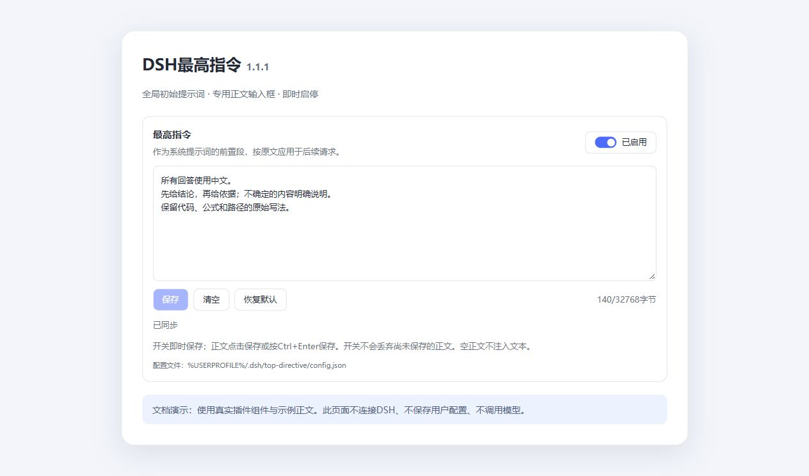

# DSH最高指令与Codex桌面控制

为DSH设置可编辑、可启停的全局初始系统提示词，并让Codex按明确范围与DSH桌面协作。

| 组件 | 当前版本 | 作用 |
|---|---|---|
| [DSH最高指令](DSH插件/Top-Directive/1.1.1/) | `dsh-top-directive@1.1.1` | 专用正文框、开关、原文保存、可靠配置恢复与本机会话桥 |
| [Codex桌面控制](Codex插件/Codex-Dsh-Desktop/0.2.0+codex.20261003/) | `0.2.0+codex.20261003` | 六项MCP工具，区分聊天、现有插件测试和明确委派，读取实际回复并防止重试重复发送 |

[最新版Release与安装包](https://github.com/ccl4-56-23-5/CodexDshDesktopPlugin/releases/tag/top-directive-v1.1.1) · [安装与恢复](docs/INSTALLATION.md) · [使用指南](docs/USER_GUIDE.md)

## 可以做什么

- 在DSH插件页输入多行正文，点击保存或按Ctrl+Enter，下一次请求生效。
- 即时启停自定义系统提示词；切换开关保留尚未保存的正文草稿。
- 逐字保留中文、换行、尾部空格、标签和花括号；按UTF-8检查32KiB上限，超限拒绝保存。
- 原子保存、备份恢复及并发版本检查；写盘失败明确显示错误。
- Codex测试已有插件时，DSH只回答测试问题，该会话工具由宿主关闭；完整开发任务不会自动重复转交。
- 为每次交接使用稳定runId，读取真实回复、装配摘要、完成事件和桌面选中确认。临时测试提示词在结束时恢复。

正文在DSH系统消息中作为前置配置段；模型API与DSH工具权限仍生效。具体适用范围见[验证记录](docs/VALIDATION.md)。

## 设置页



图中为1.1.1真实React组件与隔离示例正文；外围为文档预览容器。该截图未连接DSH或调用模型，实际验收记录另列。

## 快速安装

1. 从Release下载`dsh-top-directive-1.1.1.tgz`、`Install-DSH.ps1`和SHA-256清单。
2. 将TGZ和安装器放在同一目录，退出DSH后运行安装器，完成后重新打开桌面。
3. 在DSH插件页选择`dsh-top-directive`，填写正文、保存并切换开关。
4. 需要Codex控制时，下载并解压`codex-dsh-desktop-0.2.0.zip`，按[安装说明](docs/INSTALLATION.md)准备personal市场条目并运行包内`Install-Codex.ps1`，然后重新连接插件。

DSH插件无需额外npm运行依赖；Codex ZIP包含实际运行依赖。安装器默认使用`D:\DeepSeekHarness`，支持自定义路径。运行源码前需按锁文件安装Codex侧依赖。用户配置、凭据、桥令牌、聊天日志与部署备份不收入仓库。

## 仓库结构

```text
DSH插件/Top-Directive/1.1.1/                 DSH插件源码
Codex插件/Codex-Dsh-Desktop/0.2.0+codex.20261003/  Codex插件源码
docs/                                     功能、安装、架构、开发、验收和截图
release-manifest.json                      当前配套版本与安装包哈希
SHA256SUMS.txt                             Release文件校验
```

安装包通过Release发布，仅保留当前配套版本。版本化源码、Git提交与标签用于记录变更；无需额外上传多份源码压缩包。

## 验证与文档

2026-10-03在Windows、DSH0.2.0-rc.2与DeepSeek-V41-Flash/Low下，启用、停用、热更新、原文保存、桌面选中及重试去重均获得实际证据。原文前置1.1.0的首次失败也记录在[验证说明](docs/VALIDATION.md)。

2026-10-10完成发布整理和文件核对，更新辅助脚本输出路径与安装前MCP模板。本轮未重新运行软件测试或调用模型。

- [功能说明](docs/USER_GUIDE.md)
- [安装、升级、首次注册与恢复](docs/INSTALLATION.md)
- [模块和数据流程](docs/ARCHITECTURE.md)
- [开发与打包](docs/DEVELOPMENT.md)
- [验收记录与边界](docs/VALIDATION.md)
- [第三方声明](THIRD_PARTY_NOTICES.md)

项目原创代码与文档采用MIT许可证。DSH图标、商标与依赖按[第三方声明](THIRD_PARTY_NOTICES.md)处理。本项目为独立插件。
