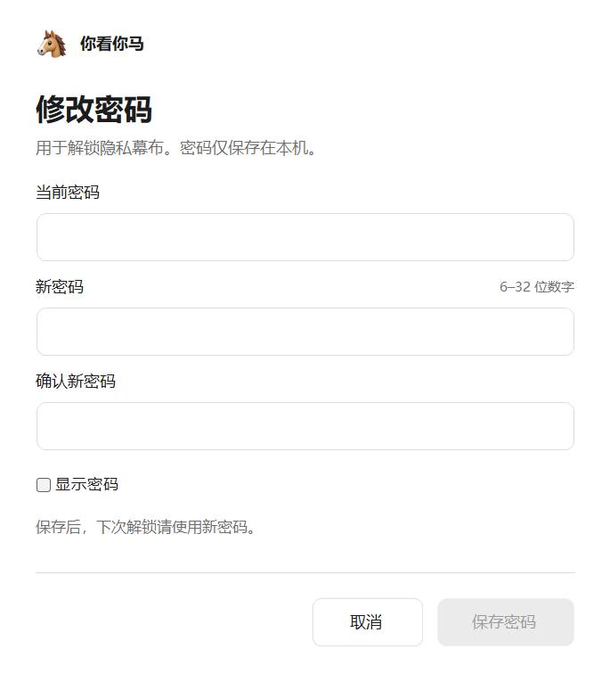
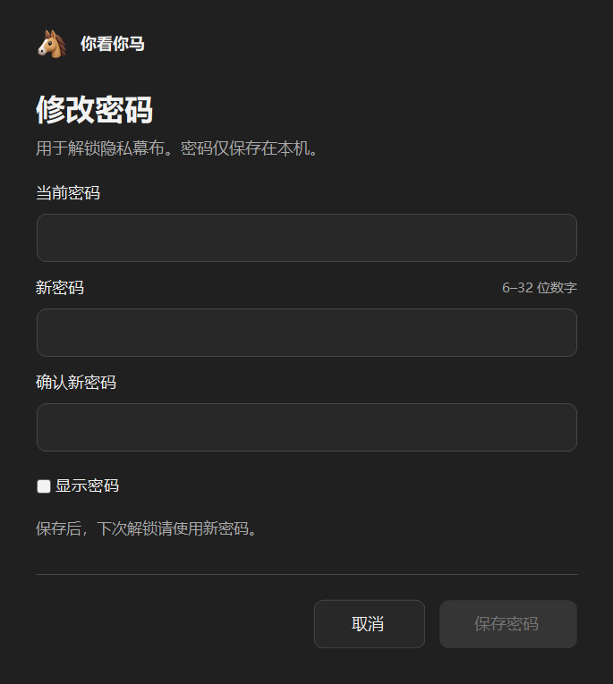

# 你看你马 1.0.3

Windows 上的多屏隐私幕布。实体键鼠被拦截，带 Windows 注入标记的自动化输入放行；支持相应接口的截图可以看到幕布下方的窗口。不会调用 Windows 锁定或暂停 Codex 任务。

## 安装与使用

1. 从 [Release](https://github.com/ccl4-56-23-5/Codex-Plugins/releases/tag/codex-privacy-curtain-v1.0.3) 下载 `CodexPrivacyCurtain-Setup-1.0.3-x64.exe`，核对同页 `SHA256SUMS.txt`。
2. 按当前用户安装。在 Codex 的 Personal 插件来源中安装、启用“你看你马”。若已配置 Codex CLI，也可执行 `codex plugin add codex-privacy-curtain@personal`。
3. 对 Codex 说“开启隐私幕布”，或使用开始菜单中的开启入口。
4. 在实体键盘直接输入密码，再按 **Enter** 解锁。Backspace 删除，Esc 清空，无须点击密码框。

初始密码 **123456**；升级保留已有密码。新密码支持 **6–32 位数字**。

改密入口：**Codex 设置 → 插件 → 你看你马 → 密码与解锁 → 修改密码**。按钮打开本地窗口，由用户输入原密码及两次新密码。旧详情页可能需要关闭后重新打开，新聊天可重新发现已更新的工具。

运行要求：Windows 10 2004 或更新版本、x64、系统 .NET Framework 4.8。无需另装 Python、Node 或系统服务。

## 改密窗口

中性色、细边框输入框、黑白按钮和马头标识；明暗跟随 Windows 应用主题，不读取 Codex 私有主题配置。支持显示密码、格式/一致性提示、保存进度及完成反馈。





以上图片是实际原生控件绘制预览，均不包含真实密码。

## 工作方式与边界

- 每个显示器创建独立的可见、置顶、不抢焦点的幕布窗口，图片完整缩放显示。
- 使用 `WDA_EXCLUDEFROMCAPTURE` 排除幕布；该功能依赖 Windows 版本、桌面合成及截图方式。
- 低级键鼠钩子阻止实体事件，放行标记为注入的事件。放行不限于 Codex，其他输入驱动需要另行验证。
- 密码以随机盐 PBKDF2-SHA256（180000轮）散列，并用当前 Windows 用户 DPAPI 加密，存于 `%LOCALAPPDATA%/CodexPrivacyCurtain/data/password.dpapi`。
- 生命周期日志只记录启动与退出原因，不记录密码或键盘输入内容。
- 幕布后台进程独立运行，关闭聊天不会自动解锁。卸载前先解锁。

这是应用层隐私遮罩，可被 Ctrl+Alt+Del、任务管理器、管理员及同用户程序绕过。不能用作系统安全锁定或恶意软件防护。异常时可从系统安全选项进入任务管理器结束 `PrivacyCurtain.exe`。

## 验证

1.0.3 包含32项缩放/校验/布局检查、9项设置协议检查、11项真实安装检查，以及隔离密码文件下的保存流程检查。证据见 `docs/*verification.json`。

幕布核心曾在两块1920×1080显示器上验证：幕布原生窗口范围与屏幕一致，Computer Use 的窗口截图、输入及点击成功。1.0.3主要变更改密UI和名称；不把UI检查等同于重新完成全部幕布、长时间守护、热插拔或所有截图驱动验证。插件设置按钮在各宿主版本上的实际显示以宿主支持为准。

## 源码与构建

`PrivacyCurtain.cs` 为幕布、输入钩子、密码、IPC和stdio MCP；`PasswordSettingsForm.cs` 为改密UI；`Register.cs` 和 `Unregister.cs` 管理当前用户的本地插件目录，保留其他插件条目。`plugin` 包含可安装的技能、清单及原生依赖；安装器在安装位置生成 `.mcp.json` 的实际路径。技术ID仍为 `codex-privacy-curtain`，以兼容已有配置。

检查源码编译（不覆盖已测试的捆绑EXE）：

```powershell
.\build.ps1 -CheckOnly
```

安装 Inno Setup 6 后构建自己的安装包：

```powershell
.\build.ps1 -InnoCompiler 'C:\Program Files (x86)\Inno Setup 6\ISCC.exe'
```

结果在本目录 `artifacts/`。源码编译可能产生不同的PE时间戳；Release提供经过测试的原始安装包，并单独校验哈希。

`verify-settings.ps1` 默认只检查设置协议和密码文件保持情况，`-OpenWindow` 可检查本地窗口打开。`UiFunctionalTest.cs` 是隔离数据的保存流程测试入口，测试数据路径必须位于 `.work`；不使用真实密码文件。

代码遵循 [MIT](LICENSE)，素材与安装器声明见 [THIRD_PARTY_NOTICES.md](THIRD_PARTY_NOTICES.md)。
